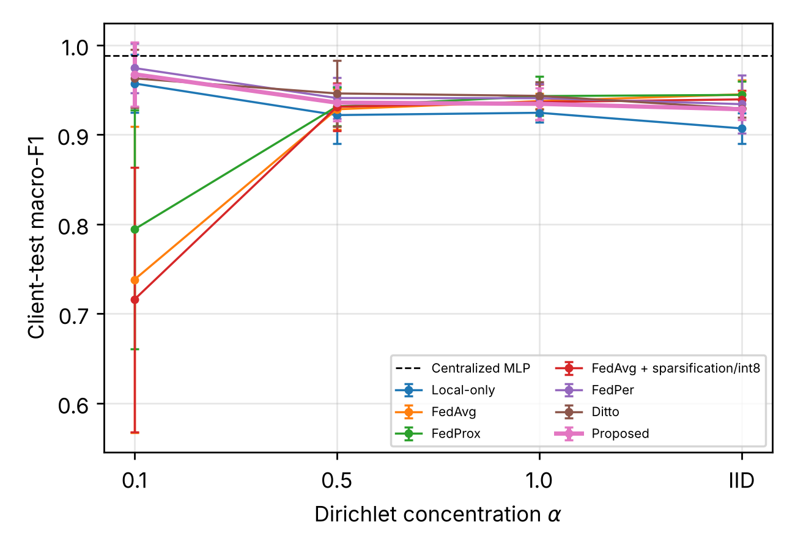
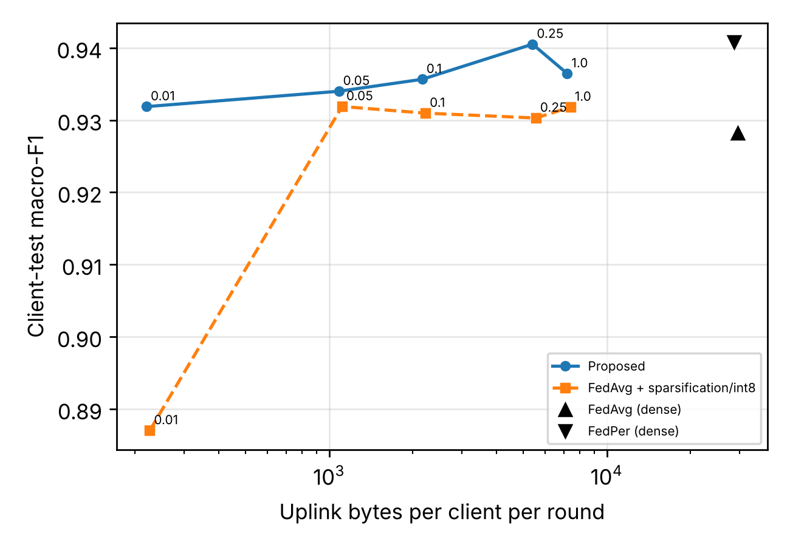
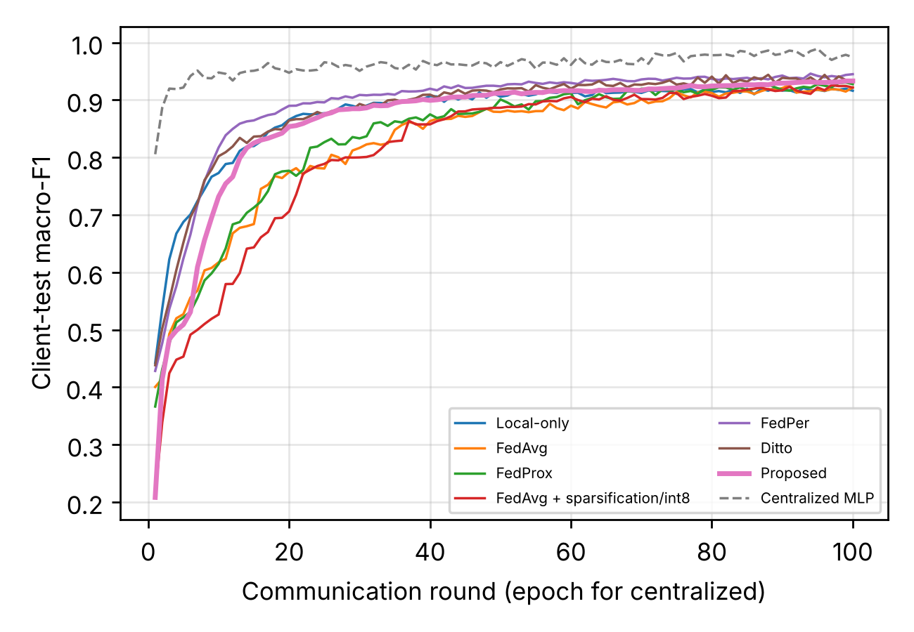

# FedLite-P: lightweight federated intrusion detection for SDN-enabled IoT

Code and raw results for the paper *"Lightweight Federated Intrusion Detection for SDN-Enabled IoT Networks with Non-IID Traffic and Communication-Efficient Personalized Updates"* (Akash B).

The code is plain Python (NumPy, SciPy, pandas, scikit-learn, matplotlib). No GPU is needed.

## Figures (InSDN dataset, five runs, mean with 95% interval)

<p align="center">
  
</p>

*Figure 1. Client-test macro-F1 versus the Dirichlet concentration alpha (T = 100 rounds, rho = 0.1).*

<p align="center">
  
</p>

*Figure 2. Client-test macro-F1 versus uplink bytes per client per round, sparsity sweep over rho (T = 100, alpha = 0.5).*

<p align="center">
  
</p>

*Figure 3. Client-test macro-F1 versus communication round (T = 100, alpha = 0.5, rho = 0.1).*

## Main results (alpha = 0.5, rho = 0.1, T = 100, mean ± 95% interval over five runs)

| Method | Client-test macro-F1 | Global-test macro-F1 | Uplink (bytes/client/round) |
|---|---|---|---|
| Centralized MLP | 0.988 ± 0.006 | 0.981 ± 0.006 | n/a |
| FedAvg | 0.928 ± 0.023 | 0.934 ± 0.019 | 29,592 |
| FedLite-P (proposed) | 0.936 ± 0.020 | 0.721 ± 0.109 | 2,164 |
| FedLite-PG (global head, lambda = 0.5) | 0.954 ± 0.022 | 0.811 ± 0.031 | 2,224 |

FedLite-P cuts the uplink by a factor of 13.7 with no significant difference in client-level macro-F1 relative to FedAvg. It lowers the global-test macro-F1 and raises the false-alarm rate. See the paper for all baselines, the ablation, the sweeps and the poisoning simulation.

## What is here

| File | Purpose |
|---|---|
| `data.py` | loading and cleaning, label unification into six classes (edit `RULES`), 70/10/20 split, Dirichlet partition |
| `fl.py` | NumPy MLP; FedAvg, FedProx, FedAvg+sparsification/int8, FedPer, Ditto, local-only, **FedLite-P**, FedLite-PG; centralized MLP and decision tree |
| `run_experiments.py` | main comparison (5 seeds); writes a results JSON |
| `sweeps100.py` | alpha and rho sweeps at 100 rounds (5 seeds) |
| `exp_extra.py` | FedLite-PG (additional global head) and label-flipping poisoning experiments, 5 seeds |
| `merge_results.py` | merges the main run and the sweeps into one file |
| `make_outputs.py` | LaTeX tables, figures and `summary.txt` (facts only) |
| other files in this folder | raw results (`*.json`), tables (`*.tex`), figures (`*.png`) and `summary_main_100_rounds.txt` used in the paper |

`results_insdn_r100.json` holds the main results (T = 100 rounds); `sweeps100_raw.json` the sweeps (T = 100);
`pilot_30_rounds_results_insdn.json` an earlier pilot with T = 30 that is mentioned in the paper but not used for its tables.

## Data (not included)

The InSDN dataset (Elsayed, Le-Khac, Jurcut, IEEE Access 8, 2020) is public; download it from its official page.
Put `Normal_data.csv`, `OVS.csv` and `metasploitable-2.csv` in one folder. Raw data are not redistributed here.

## Reproduce the paper's results

```
pip install -r requirements.txt
python run_experiments.py --rounds 100 --no-sweeps --out results_insdn_r100.json \
  --data InSDN=DATA/Normal_data.csv,DATA/OVS.csv,DATA/metasploitable-2.csv
python sweeps100.py --data-dir DATA
python merge_results.py --main results_insdn_r100.json --sweeps sweeps100_raw.json --out results_merged.json
python make_outputs.py --results results_merged.json --outdir outputs
python exp_extra.py --data-dir DATA --out extra_results.json
```

Replace `DATA` with your folder. The main run takes about 10 minutes, the sweeps about 35 minutes and the extra experiments about 25 minutes on one CPU core.
Seeds 0 to 4 control the split, partition and initialization, so reruns should match the stored results up to small numerical differences between platforms.

Result keys in `extra_results.json`: `pg|alpha=...|seed` (FedLite-PG, with a lambda sweep under `lam_sweep`) and `poison2|method|frac=...|seed` (poisoning, honest clients only).
Keys starting with `poison|` come from a first run that also scored the malicious clients' own models; they are kept for transparency and are not used in the paper.

Quick check on synthetic data (the numbers are meaningless; never report them):

```
python run_experiments.py --synthetic --seeds 1 --rounds 3 --no-sweeps --out test.json
```

## Protocol summary

K = 20 clients, class-wise Dirichlet partition (alpha = 0.5 main), E = 1 local epoch, Adam (learning rate 1e-3, batch 128), MLP 64-32, FedProx mu = 0.01, Ditto lambda = 0.1,
top-k fraction rho = 0.1 with int8 quantization and error feedback. Split 70/10/20; the validation split picks the reported round.
Exact duplicates are removed before splitting; at most 20,000 flows per class are kept. Hyper-parameters were fixed, not tuned per method.

## Limits

One dataset, a public flow dataset rather than a live SDN testbed, an honest server assumed, payload bytes only, one simulated poisoning attack. See Section 7 of the paper.

## License

MIT (see `LICENSE`). Datasets keep their own licenses.

## Citation

Cite the paper (details to be added after publication).
